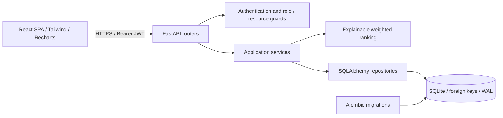

# Architecture

## System

The API is the security boundary. Route guards are a UX convenience, not
authorization. Services own transactions and workflow transitions; repositories
own persistence queries. Pydantic DTOs validate input and serialize output.
Domain models and policy functions do not depend on the browser.

## Decisions

- React JavaScript with Vite, Tailwind, React Router, Axios, and Recharts.
- Python 3.11+ with FastAPI, SQLAlchemy 2, Alembic, Pydantic Settings, PyJWT,
  and bcrypt. Pytest exercises the HTTP API against isolated SQLite databases.
- SQLite is suitable for a single-instance, medium-scale deployment. Enable
  foreign keys, busy timeout, WAL, indexes and bounded queries. No network-shared
  database file. Move to PostgreSQL before multi-writer horizontal scaling.
- Money uses fixed-point decimal storage and is denominated in USD in this release.
- All timestamps are UTC. Delivery targets are dates.
- Public registration creates employees only. Admins manage roles and activation.
  Demo accounts are created only by an explicit development seed command.
- Short-lived access tokens live in browser memory. Rotating, persisted, hashed
  refresh-token identifiers live in an HttpOnly, SameSite cookie. Logout revokes
  the refresh session; access JWTs expire promptly. Production requires HTTPS.
- Employees see their own requests and discussions; managers see their team's
  requests (a manager_id relationship), admins see all. Vendors see only orders
  for their linked supplier. Directory access excludes vendors.
- Supplier deletion is blocked when referenced by orders. User deactivation
  preserves history. Comments use tombstones to preserve threaded replies.
- Audit events record approvals and order transitions with actor/time.
- Recommendation is deterministic decision support, not a trained ML model.
  It never silently places an order.

## Recommendation contract

Only suppliers matching an approved request's category are eligible. Normalize
all inputs to [0,1]: price score / 100, rating / 5, delivery score =
1 / (1 + average_delivery_days / 7), reliability / 100.

`score = 100 * (.40 * price + .25 * rating + .20 * delivery + .15 * reliability)`

Higher price score means better value, not higher cost. Return at most three,
ordered by unrounded score descending then supplier ID ascending. Explanations
show factor contributions. A directory price score is not a supplier quote;
orders snapshot the approved estimated budget, not an invented actual price.

## Reliability and operations

Environment-based configuration, startup validation, structured logging without
tokens/passwords, safe error responses, request IDs, CORS allowlist, migrations
before startup, and transactional writes. API docs are served by Swagger/OpenAPI.
Deploy behind a TLS reverse proxy with rate limiting. Back up the database using
SQLite's backup API and test restores. Never ship demo data or development secrets.
