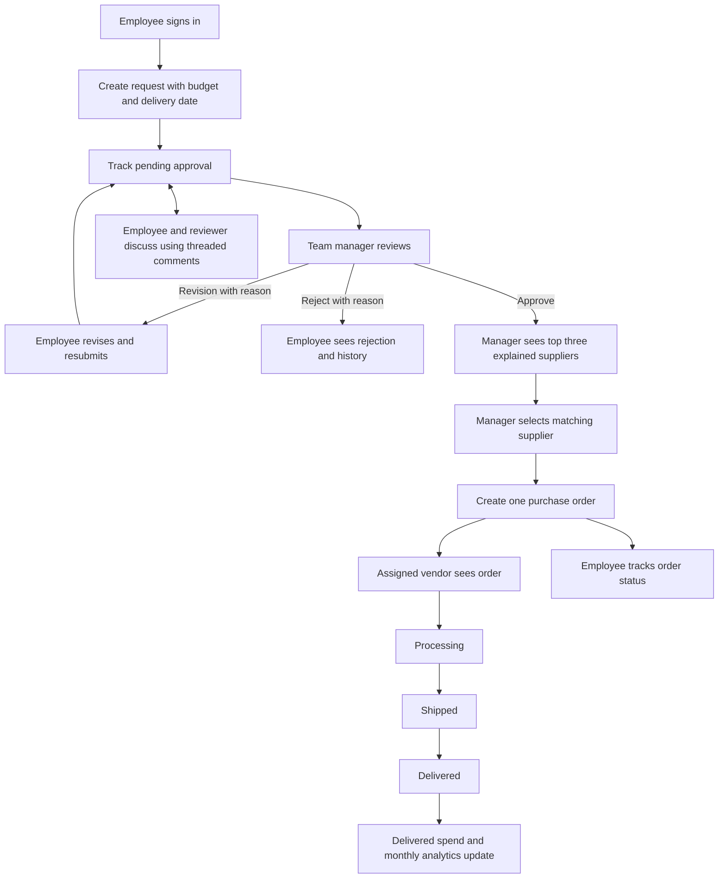
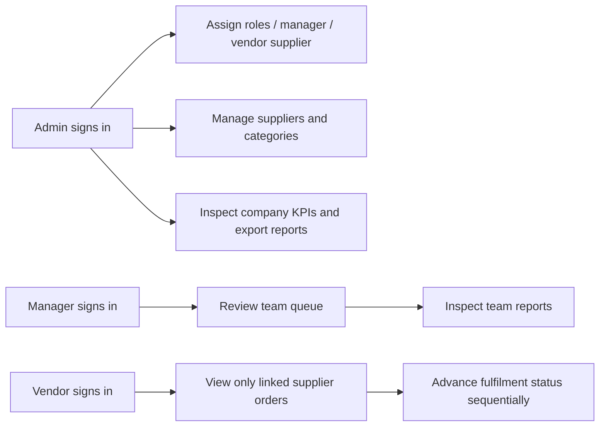

# User journeys

Unauthenticated deep links go to sign-in. Expired sessions are restored only with
a valid rotating refresh cookie. Unauthorized resources appear unavailable.
Concurrent approval or duplicate order attempts produce actionable conflict
messages. Empty recommendation results explain that the category needs suppliers.
