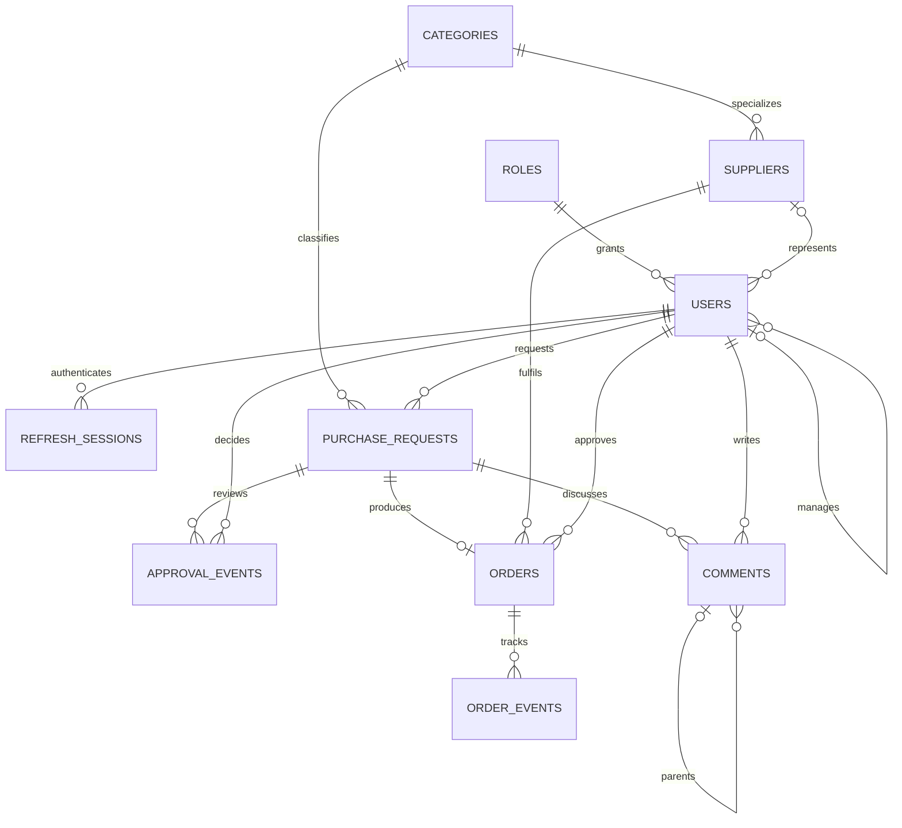
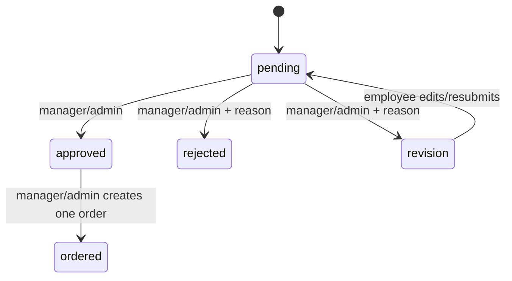
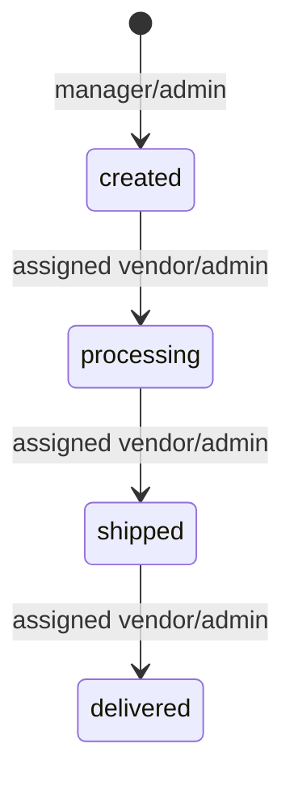

# Database schema

All IDs are integer primary keys. Foreign keys are enforced. Timestamps default
to UTC server time. API DTOs expose role/category names while storage uses names
as foreign keys for these small controlled vocabularies.

| Table | Columns and constraints |
| --- | --- |
| roles | name PK; employee, manager, admin, vendor |
| categories | name PK, 1-80 characters |
| suppliers | id, company_name, category FK, rating decimal [0,5], average_price_score decimal [0,100], average_delivery_days integer [1,365], reliability_score decimal [0,100], contact_person, email |
| users | id, full_name, email unique normalized, password_hash, role FK, is_active, created_at, manager_id nullable users FK, supplier_id nullable suppliers FK |
| refresh_sessions | id (random UUID), user_id FK, token_hash unique, expires_at, revoked_at nullable |
| purchase_requests | id, title (item name), description (justification), category FK, estimated_budget decimal(12,2) > 0, quantity integer > 0, target_delivery_date, status, requested_by FK, created_at, updated_at |
| approval_events | id, request_id FK, actor_id FK, decision, reason, created_at |
| orders | id, request_id unique FK, supplier_id FK, approved_by users FK, status, amount decimal(12,2), order_date, delivery_date nullable, updated_at |
| order_events | id, order_id FK, actor_id FK, status, created_at |
| comments | id, request_id FK, user_id FK, parent_comment_id nullable self FK, content, is_deleted, created_at, updated_at |

Indexes: normalized user email (unique), request owner/status/date, supplier
category, order supplier/status/date, comments request/parent, refresh expiry.
Order amounts and supplier assignments are immutable after creation. Numeric
checks exist in both DTO validation and database constraints.

## State machines

Employees may edit pending or revision requests only. A pending edit stays pending.
Rejection is terminal. Reviewers cannot approve their own requests. Managers may
review only their team's requests. Concurrent duplicate decisions/orders are
rejected, not silently overwritten.

No backwards or skipped transitions. Delivery sets the completion timestamp.
Order creation requires an approved request and a category-matching supplier.
